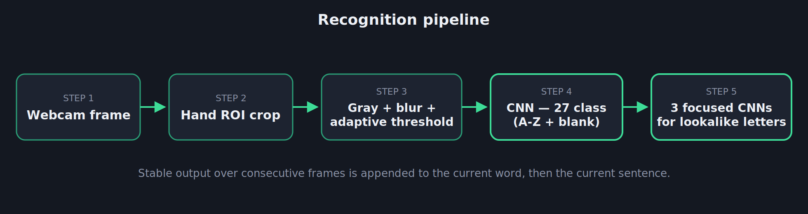
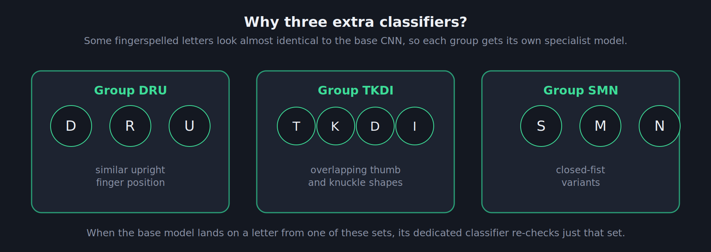

<div align="center">

# SignSpeak

**A camera-based ASL fingerspelling reader — hand shapes in, sentences out.**

</div>

---

## What this is

Point a webcam at a hand signing the ASL alphabet, and SignSpeak reads it back as text in real time — letter by letter, then word by word, then sentence by sentence. Under the hood it's a small ensemble of convolutional neural networks: one general-purpose classifier, backed up by three specialists trained specifically for the letters that tend to get confused with each other.

<p align="center">
  
</p>

## Table of contents

- [Motivation](#motivation)
- [Architecture](#architecture)
- [Repository layout](#repository-layout)
- [Getting started](#getting-started)
- [Usage](#usage)
- [Accuracy](#accuracy)
- [Known limitations](#known-limitations)
- [License](#license)

## Motivation

Sign language is a full, natural language — but most hearing people never learn it, and interpreters aren't always around when they're needed. Fingerspelling (signing a word letter-by-letter) is a narrower, more mechanical slice of ASL than full signing, which makes it a tractable target for a first pass at computer-vision-assisted translation. This project is that first pass: not a substitute for an interpreter, but a demonstration of how far a webcam and a CNN can get on the alphabet alone.

## Architecture

**Frame capture.** A fixed rectangle on screen marks where the signing hand should be held; everything outside it is ignored.

**Preprocessing.** The cropped region is converted to grayscale, blurred, and pushed through an adaptive threshold plus Otsu binarization. The result is a clean black-and-white silhouette of the hand — this is what the model actually sees, not the raw color image.

**Primary classification.** The 128×128 silhouette goes into a CNN trained on all 27 classes (the 26 letters, plus a "no hand" / blank class).

**Disambiguation pass.** A few letter groups are visually close enough that a general model regularly mixes them up. Rather than trying to force one network to nail all of them, three smaller CNNs each specialize in a narrow set of lookalikes:

<p align="center">
  
</p>

**Temporal smoothing.** A single frame's prediction is noisy — hands shake, lighting flickers. A letter only gets committed once it's dominated the prediction across a run of consecutive frames. Once committed, letters accumulate into the current word; a sustained blank closes the word out into the running sentence. Hunspell-backed autocomplete suggests likely finished words as you go.

## Repository layout

```
SignSpeak/
├── Application.py             Main desktop app — camera view, live prediction, sentence builder
├── FoldersCreation.py         Sets up the dataSet/ directory tree (run once)
├── TrainingDataCollection.py  Capture tool for building the training set from your own webcam
├── TestingDataCollection.py   Same, for a held-out test set
├── requirements.txt
├── Models/                    Model architectures (.json) + trained weights (.h5) go here
├── dataSet/                   trainingData/ and testingData/, one folder per class (0, A-Z)
└── assets/                    Diagrams used in this README
```

## Getting started

**Requirements:** Python 3.8+, a webcam.

```bash
git clone <this-repo-url>
cd SignSpeak
pip install --upgrade pip
pip install -r requirements.txt
```

`tkinter` normally ships with Python; if it's missing on Linux, install it separately (e.g. `sudo apt install python3-tk`).

Then drop your trained model files into `Models/` and your image data into `dataSet/` (see the notes in each folder for the exact filenames/layout expected).

## Usage

**1. Set up the dataset folders** (only needed once, if collecting your own images):

```bash
python FoldersCreation.py
```

**2. Collect labeled images** by holding a hand shape in front of the camera and pressing the corresponding key — `0` for the blank class, `a`–`z` for letters, `Esc` to stop:

```bash
python TrainingDataCollection.py
python TestingDataCollection.py
```

**3. Run the app:**

```bash
python Application.py
```

The window shows the raw camera feed, the processed hand silhouette, the currently detected letter, the word being spelled, the sentence built so far, and a row of spelling suggestions you can click to auto-complete the current word.

## Accuracy

On the held-out test set, the base classifier alone lands around **95.8%**. Layering in the three disambiguation models pushes overall accuracy to roughly **98.0%** across all 26 letters. Training/evaluation code and confusion matrices live in `Models/Model.ipynb`.

## Known limitations

- Recognition quality depends heavily on lighting and background — the thresholding step assumes a reasonably uncluttered background behind the hand.
- This covers fingerspelling only. Full ASL involves facial expression, motion, and non-manual markers that aren't modeled here.
- The training data was self-collected, so performance may not generalize evenly across different hands, skin tones, or lighting setups. Treat this as a learning/portfolio project, not a validated accessibility product.

## License

MIT — see [LICENSE](LICENSE).
